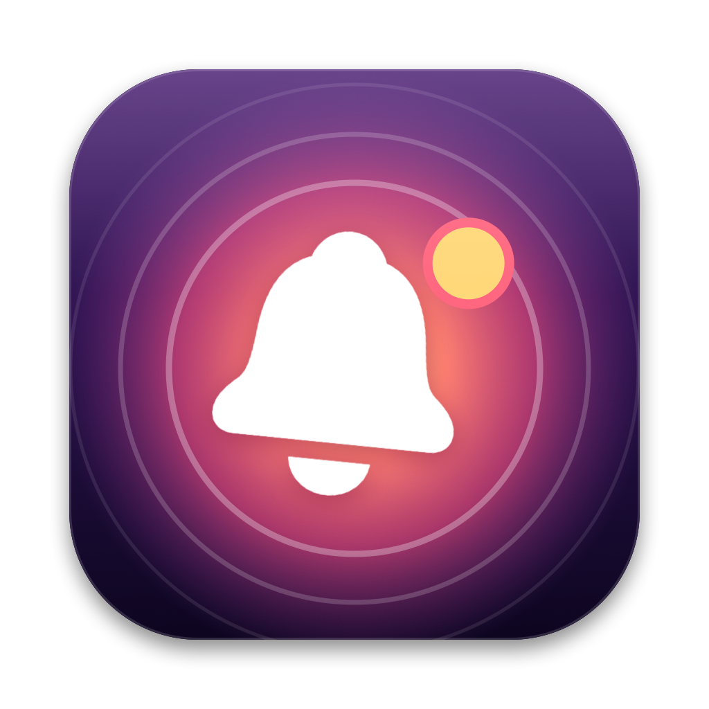

# Blink

A tiny macOS menu bar reminder app that refuses to be ignored.

Add a reminder in two seconds; when it's due, Blink takes over **every screen** with a huge, animated alert (and, if you like, a monster engine start) until you deal with it.

## Install

You need a Mac on macOS 14 or newer with the Xcode Command Line Tools:

```bash
xcode-select --install
```

Then:

```bash
git clone https://github.com/berkbatu/blink.git
cd blink
./build.sh
```

That compiles the app, paints its icon, synthesizes its sounds, installs it to `~/Applications/Blink.app` and launches it. Look for the 🔔 in your menu bar. To have it start automatically, click the sunrise icon at the bottom of the panel (“Open at login”).

Building it yourself means no Gatekeeper “unidentified developer” warning. To update later: `git pull && ./build.sh`.

## Using it

- **Click the bell** (or press **⌥⌘B** anywhere) and type. Press ↩ to save.
- **Put the time in the text** and Blink picks it up:
  - `call mom in 20m`
  - `tea at 17:30`
  - `dinner tomorrow 8pm`
  - `standup every weekday 9:30`
  - `gym every monday 7pm`
- Or **drag the timeline**, tap a quick time (15m, 1h, 3h, Tonight, Tomorrow) or pick a date from the calendar.
- **Upcoming** lists everything grouped by day; hover a row to finish it early ✓ or delete it ✕ (with undo).
- **History** shows what already went off and how you handled it; hover to bring one back in 15 minutes.
- **Sound menu** (bottom left): Chime, Monster engine start, Silent, or **Your own sound…** to use any audio file.

When a reminder is due:

| Key | Action |
| --- | --- |
| ↩ | Got it (confetti) |
| 1 / 2 / 3 | Snooze 5 min / 15 min / 1 hour |
| Esc | Snooze 5 min |

Reminders missed while your Mac was asleep fire as soon as it wakes.

## Files

- `Blink.swift`: the whole app (SwiftUI + AppKit, no dependencies)
- `build.sh`: builds, signs ad hoc, installs and launches
- `tools/icon.swift`: draws the app icon
- `tools/sounds.py`: synthesizes the chime, pop, done and engine sounds from scratch

Your data lives in `~/Library/Application Support/Blink/`.

## Uninstall

```bash
pkill -x Blink; rm -rf ~/Applications/Blink.app ~/Library/Application\ Support/Blink
```
